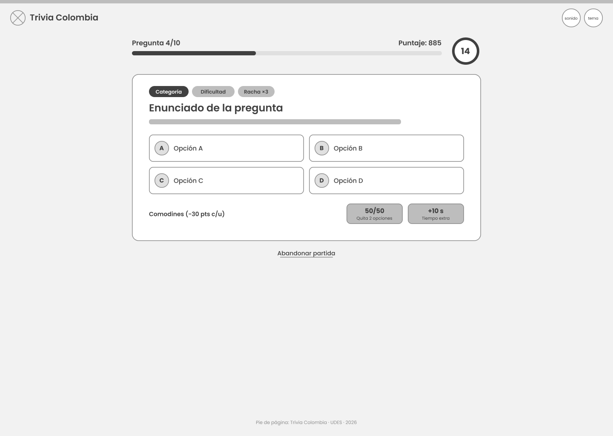
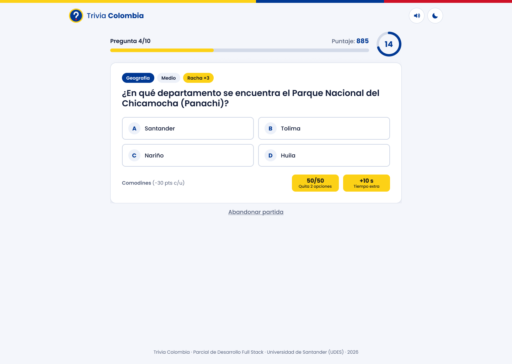
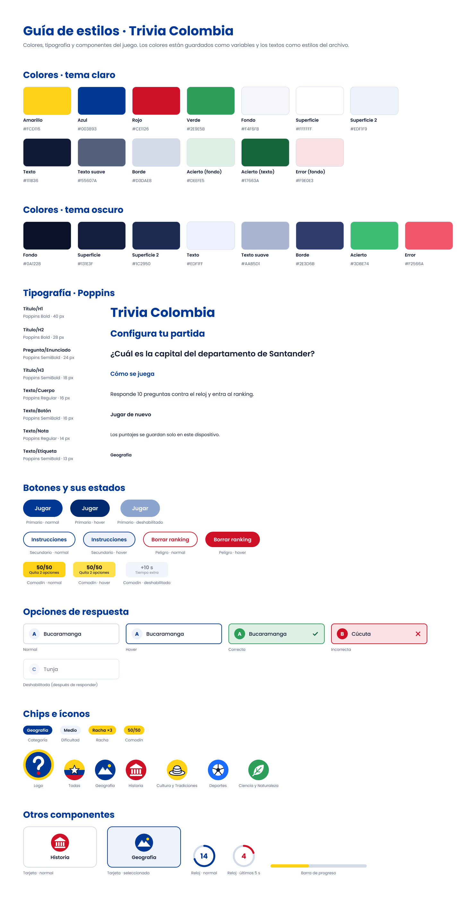

# Trivia Colombia – Juego de preguntas

Juego web de preguntas y respuestas sobre Colombia. El jugador escribe su nombre, elige una categoría y un nivel
de dificultad y responde una ronda de 10 preguntas de selección múltiple con tiempo límite. Cada acierto suma
puntos según la rapidez y, al final, el resultado se guarda en un ranking local.

Parcial de **Desarrollo Full Stack** · Universidad de Santander (UDES) · Docente: Carlos Carrascal · Octubre de 2026

## Integrantes

| Nombre | GitHub |
| --- | --- |
| Eder Rosadas De Oliveira Barrera | [@EDER1002](https://github.com/EDER1002) |
| María Fernanda Jaimes Manganiello | [@fmanganielo-026](https://github.com/fmanganielo-026) |

## Enlaces

| Entregable | Enlace |
| --- | --- |
| Diseño (Figma) | https://www.figma.com/design/BdYMvZWORXnRtHcv0GcpXW |
| Prototipo navegable – escritorio | [Reproducir en Figma](https://www.figma.com/proto/BdYMvZWORXnRtHcv0GcpXW?page-id=5%3A3&node-id=6-51&starting-point-node-id=6%3A51&scaling=scale-down) |
| Prototipo navegable – móvil | [Reproducir en Figma](https://www.figma.com/proto/BdYMvZWORXnRtHcv0GcpXW?page-id=5%3A3&node-id=6-99&starting-point-node-id=6%3A99&scaling=scale-down) |
| Despliegue en Vercel | https://trivia-colombia.vercel.app |
| Video explicativo | _pendiente_ |

## Diseño en Figma

El diseño se hizo antes del código. El archivo de Figma tiene tres secciones (páginas):

| Sección | Qué contiene | Abrir en Figma | Exportado en el repositorio |
| --- | --- | --- | --- |
| 1. Wireframes | Las 7 pantallas en escala de grises, en escritorio (1440 × 1024) y móvil (375 × 812). | [Ver sección](https://www.figma.com/design/BdYMvZWORXnRtHcv0GcpXW?node-id=0-1) | [`docs/diseno/wireframes`](docs/diseno/wireframes) |
| 2. Guía de estilos | Paleta de colores, tipografía y componentes con sus estados (normal, hover, correcto, incorrecto y deshabilitado). | [Ver sección](https://www.figma.com/design/BdYMvZWORXnRtHcv0GcpXW?node-id=5-2) | [`guia-de-estilos.png`](docs/diseno/guia-de-estilos.png) |
| 3. Mockups y prototipo | Mockups de alta fidelidad en escritorio y móvil, más el tema oscuro, conectados como prototipo navegable. | [Ver sección](https://www.figma.com/design/BdYMvZWORXnRtHcv0GcpXW?node-id=5-3) | [`docs/diseno/mockups`](docs/diseno/mockups) |

### Cómo reproducir el prototipo

1. Abre el enlace del prototipo de [escritorio](https://www.figma.com/proto/BdYMvZWORXnRtHcv0GcpXW?page-id=5%3A3&node-id=6-51&starting-point-node-id=6%3A51&scaling=scale-down) o de [móvil](https://www.figma.com/proto/BdYMvZWORXnRtHcv0GcpXW?page-id=5%3A3&node-id=6-99&starting-point-node-id=6%3A99&scaling=scale-down). Arranca en la pantalla de inicio.
2. Haz clic en los botones como si jugaras: **Jugar** → **Comenzar** → elige una opción → **Siguiente pregunta** → **Resultado** → **Ver ranking**.
3. En la pantalla de juego, la opción **A** lleva a la retroalimentación correcta y las demás a la incorrecta. El botón de la luna cambia al tema oscuro.
4. El logo y **Abandonar partida** vuelven al inicio. Las pantallas largas se desplazan hacia abajo con la rueda del ratón.

También se puede abrir el archivo de Figma, ir a la sección 3 y pulsar **Present** (▶), eligiendo el flujo «Escritorio» o «Móvil».

### Mockups y wireframes por pantalla

| Pantalla | Wireframe | Mockup |
| --- | --- | --- |
| 1 Inicio | [escritorio](docs/diseno/wireframes/1-inicio-escritorio.png) · [móvil](docs/diseno/wireframes/1-inicio-movil.png) | [escritorio](docs/diseno/mockups/escritorio-1-inicio.png) · [móvil](docs/diseno/mockups/movil-1-inicio.png) |
| 2 Instrucciones | [escritorio](docs/diseno/wireframes/2-instrucciones-escritorio.png) · [móvil](docs/diseno/wireframes/2-instrucciones-movil.png) | [escritorio](docs/diseno/mockups/escritorio-2-instrucciones.png) · [móvil](docs/diseno/mockups/movil-2-instrucciones.png) |
| 3 Configuración de partida | [escritorio](docs/diseno/wireframes/3-configuracion-escritorio.png) · [móvil](docs/diseno/wireframes/3-configuracion-movil.png) | [escritorio](docs/diseno/mockups/escritorio-3-configuracion.png) · [móvil](docs/diseno/mockups/movil-3-configuracion.png) |
| 4 Juego | [escritorio](docs/diseno/wireframes/4-juego-escritorio.png) · [móvil](docs/diseno/wireframes/4-juego-movil.png) | [escritorio](docs/diseno/mockups/escritorio-4-juego.png) · [móvil](docs/diseno/mockups/movil-4-juego.png) |
| 5 Retroalimentación (correcta) | [escritorio](docs/diseno/wireframes/5-retroalimentacion-escritorio.png) · [móvil](docs/diseno/wireframes/5-retroalimentacion-movil.png) | [escritorio](docs/diseno/mockups/escritorio-5-retroalimentacion-correcta.png) · [móvil](docs/diseno/mockups/movil-5-retroalimentacion-correcta.png) |
| 5b Retroalimentación (incorrecta) | — | [escritorio](docs/diseno/mockups/escritorio-5b-retroalimentacion-incorrecta.png) · [móvil](docs/diseno/mockups/movil-5b-retroalimentacion-incorrecta.png) |
| 6 Resultado | [escritorio](docs/diseno/wireframes/6-resultado-escritorio.png) · [móvil](docs/diseno/wireframes/6-resultado-movil.png) | [escritorio](docs/diseno/mockups/escritorio-6-resultado.png) · [móvil](docs/diseno/mockups/movil-6-resultado.png) |
| 7 Ranking y estadísticas | [escritorio](docs/diseno/wireframes/7-ranking-escritorio.png) · [móvil](docs/diseno/wireframes/7-ranking-movil.png) | [escritorio](docs/diseno/mockups/escritorio-7-ranking.png) · [móvil](docs/diseno/mockups/movil-7-ranking.png) |
| 8 Juego en tema oscuro | — | [escritorio](docs/diseno/mockups/escritorio-8-juego-tema-oscuro.png) · [móvil](docs/diseno/mockups/movil-8-juego-tema-oscuro.png) |

| Wireframe | Mockup |
| --- | --- |
|  |  |

### Paleta de colores

Inspirada en la bandera de Colombia. Cada color está definido como variable en `css/styles.css` y como variable de color en Figma.

| Color | Tema claro | Tema oscuro | Uso |
| --- | --- | --- | --- |
| Amarillo (acento) | &nbsp;`#FCD116` | &nbsp;`#FCD116` | Barra de progreso, comodines, racha y botón principal en tema oscuro |
| Azul (principal) | &nbsp;`#003893` | &nbsp;`#FCD116` | Títulos, botón principal y chip de categoría |
| Rojo (error) | &nbsp;`#CE1126` | &nbsp;`#F2566A` | Respuesta incorrecta, alertas y botón «Borrar ranking» |
| Verde (acierto) | &nbsp;`#2E9E5B` | &nbsp;`#3DBE74` | Respuesta correcta |
| Fondo | &nbsp;`#F4F6FB` | &nbsp;`#0A1228` | Fondo de la página |
| Superficie | &nbsp;`#FFFFFF` | &nbsp;`#131E3F` | Tarjetas |
| Superficie 2 | &nbsp;`#EDF1F9` | &nbsp;`#1C2950` | Cajas internas, cifras y retroalimentación |
| Texto | &nbsp;`#111B36` | &nbsp;`#EDF1FF` | Texto principal |
| Texto suave | &nbsp;`#55607A` | &nbsp;`#AAB5D1` | Notas, etiquetas y pie de página |
| Borde | &nbsp;`#D3DAE8` | &nbsp;`#2E3D6B` | Bordes de tarjetas, campos y opciones |

### Tipografía

[Poppins](https://fonts.google.com/specimen/Poppins) de Google Fonts: Bold para títulos, SemiBold para enunciados y botones, Regular para el texto.
Los botones miden mínimo 48 px de alto para que sean fáciles de tocar en el celular.



## Capturas de la aplicación

| Inicio | Configuración de partida |
| --- | --- |
|  |  |

| Juego | Retroalimentación |
| --- | --- |
|  |  |

| Resultado | Ranking y estadísticas |
| --- | --- |
|  |  |

Versión móvil (375 px) y tema oscuro:

<p>
  
  
  
  
</p>

## Tecnologías

| Tecnología | Uso |
| --- | --- |
| HTML5 | Estructura semántica (`header`, `main`, `section`, `footer`, `dialog`). |
| CSS3 | Variables, Flexbox, Grid, media queries, animaciones y tema oscuro. |
| JavaScript (ES6+) | Lógica del juego, manipulación del DOM, eventos y temporizador. |
| localStorage | Ranking, estadísticas y preferencias del jugador. |
| Figma | Wireframes, mockups, guía de estilos y prototipo navegable. |
| Git y GitHub | Control de versiones. |
| Vercel | Despliegue. |

No usa frameworks, librerías ni servidor: todo corre en el navegador. El código está formateado con [Prettier](https://prettier.io/).

## Cómo ejecutarlo localmente

1. Clonar el repositorio:
   ```bash
   git clone https://github.com/EDER1002/trivia-colombia.git
   ```
2. Abrir la carpeta en Visual Studio Code.
3. Clic derecho sobre `index.html` → **Open with Live Server**.

También funciona abriendo `index.html` directamente con doble clic, porque no necesita servidor.

## Estructura del proyecto

```text
trivia-colombia/
├── index.html            → Estructura de todas las pantallas
├── css/
│   ├── styles.css        → Estilos generales y variables (guía de estilos)
│   └── responsive.css    → Media queries (tableta y celular)
├── js/
│   ├── app.js            → Punto de entrada, eventos y navegación
│   ├── juego.js          → Lógica: preguntas, tiempo, comodines y puntaje
│   ├── preguntas.js      → Banco de preguntas (solo datos)
│   ├── ui.js             → Renderizado de pantallas en el DOM
│   └── almacenamiento.js → Ranking, estadísticas y preferencias (localStorage)
├── assets/
│   ├── img/              → Logo e íconos de las categorías (SVG)
│   └── sonidos/          → Efectos de acierto y error
├── docs/
│   ├── diseno/           → Wireframes, mockups, guía de estilos y paleta exportados de Figma
│   └── capturas/         → Capturas de la aplicación
└── README.md
```

## Reglas del juego

- 10 preguntas al azar por partida, sin repetir, con las 4 opciones en orden aleatorio.
- 20 segundos por pregunta; si se agota el tiempo cuenta como incorrecta.
- Comodines (uno de cada uno por partida): **50/50** elimina dos opciones incorrectas y **+10 s** suma tiempo.
- Al responder se marca la opción elegida, se resalta la correcta y se muestra una explicación.

| Concepto | Puntos |
| --- | --- |
| Respuesta correcta | +100 |
| Bonificación por rapidez | +5 por cada segundo restante (máximo +100) |
| Racha de 3 respuestas correctas seguidas | +50 |
| Respuesta incorrecta o sin responder | 0 |
| Uso de un comodín | −30 |
| Multiplicador por dificultad | Fácil ×1 · Medio ×1.5 · Difícil ×2 |

Atajos de teclado: teclas `1`–`4` o `A`–`D` para responder y `Enter` para continuar.

## Decisiones de implementación

- **Banco de 150 preguntas.** El enunciado pide mínimo 50 (10 por categoría), pero una partida filtra por categoría
  **y** dificultad y necesita 10 preguntas distintas (caso CP-02). Por eso hay 10 preguntas por cada una de las
  15 combinaciones. Si se quitaran preguntas, `obtenerPreguntas()` completa con otras dificultades de la misma categoría.
- **Bonificación de racha.** Se suma +50 cada vez que la racha llega a 3, 6 o 9 aciertos seguidos.
- **Multiplicador.** Se aplica a los puntos de cada pregunta (base + rapidez + racha), como indica el caso CP-04.
- **Comodines.** Restan 30 puntos fijos (sin multiplicador). El puntaje final nunca queda por debajo de 0.
- **Estadísticas por jugador.** Se guardan por nombre (sin distinguir mayúsculas), incluido el mejor puntaje por
  combinación de categoría y dificultad que se muestra al configurar la partida.
- **Seguridad.** Los textos se insertan con `textContent`, así el nombre del jugador no puede inyectar HTML.

### Datos en localStorage

| Clave | Contenido |
| --- | --- |
| `trivia_ranking` | Arreglo (top 10) de `{ nombre, puntaje, categoria, dificultad, aciertos, fecha }` |
| `trivia_stats` | Estadísticas por jugador: partidas, aciertos, mejor puntaje y desempeño por categoría |
| `trivia_prefs` | `{ sonido, tema, nombre }` |

## Funciones principales

| Función | Archivo | Descripción |
| --- | --- | --- |
| `iniciarPartida(categoria, dificultad)` | juego.js | Reinicia el estado, selecciona las preguntas y muestra la primera. |
| `obtenerPreguntas(categoria, dificultad)` | juego.js | Filtra el banco, lo mezcla y devuelve 10 preguntas. |
| `mezclar(arreglo)` | juego.js | Ordena un arreglo al azar (Fisher-Yates). |
| `iniciarTemporizador()` | juego.js | Cuenta regresiva con `setInterval`; detecta el tiempo agotado. |
| `responder(indiceOpcion)` | juego.js | Valida la respuesta, calcula los puntos y actualiza la racha. |
| `calcularPuntos(segundos, racha, dificultad)` | juego.js | Aplica las reglas de puntuación. |
| `usarComodin(tipo)` | juego.js | Aplica el 50/50 o el tiempo extra y descuenta puntos. |
| `mostrarPregunta()` / `mostrarResultado()` | ui.js | Renderizan las pantallas en el DOM. |
| `guardarEnRanking(partida)` | almacenamiento.js | Agrega la partida, ordena y conserva el top 10. |

## Pruebas realizadas

| ID | Caso de prueba | Resultado |
| --- | --- | --- |
| CP-01 | Iniciar sin escribir el nombre | Muestra el mensaje y no avanza ✔ |
| CP-02 | Partida de Historia en nivel fácil | 10 preguntas distintas de esa categoría y nivel ✔ |
| CP-03 | Dos partidas seguidas con los mismos filtros | Cambia el orden de preguntas y opciones ✔ |
| CP-04 | Acierto con 12 segundos restantes | Suma 100 + 60 puntos ✔ |
| CP-05 | Respuesta incorrecta | Elegida en rojo, correcta en verde y explicación ✔ |
| CP-06 | Dejar agotar el tiempo | Cuenta como incorrecta con 0 puntos ✔ |
| CP-07 | Clic en otra opción después de responder | No ocurre nada ✔ |
| CP-08 | Comodín 50/50 | Desaparecen dos incorrectas y el botón queda deshabilitado ✔ |
| CP-09 | Tres aciertos seguidos | Suma la bonificación de +50 ✔ |
| CP-10 | Terminar una partida | Muestra el resumen y aparece en el ranking ✔ |
| CP-11 | Recargar la página | Se conservan ranking y estadísticas ✔ |
| CP-12 | Comparar con el diseño | Las pantallas, colores y componentes coinciden con los mockups de Figma ✔ |
| CP-13 | Celular de 360 px | Sin desplazamiento horizontal en ninguna pantalla ✔ |

## Mejoras futuras

- Backend con API y base de datos para un ranking en línea.
- Registro e inicio de sesión.
- Panel para que el docente agregue y edite preguntas.
- Retos diarios y versión PWA instalable.
